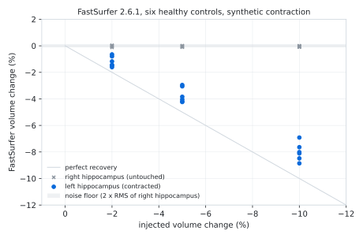

# bidsgate

[](https://github.com/CedricConday/bidsgate/actions/workflows/tests.yml)

**A recovery gate for neuroimaging pipelines.** Inject a known truth into real BIDS data,
run any BIDS app on the result, and score what it recovered. Every pipeline claims to
segment lesions or measure atrophy; this is the test that says by how much.

```bash
pip install bidsgate            # bidsgate[phantom] for longphantom
bidsgate inject-lesions /data/bids --out /data/derivatives/bidsgate-lesions
# run your lesion segmenter on /data/derivatives/bidsgate-lesions
bidsgate score-lesions --truth /data/derivatives/bidsgate-lesions \
    --pred "/data/derivatives/mytool/{subject}/{base}_seg.nii.gz" --pipeline mytool
```

> Nothing in this repository is evidence about any disease. It is a test of software:
> the injected lesions and volume changes are synthetic, and the only claim made is
> about what a given pipeline recovered from them.

## Why

There is no public ground truth for most of what neuroimaging pipelines report. Lesion
segmenters are compared to expert masks that disagree with each other; morphometry tools
report volumes nobody can check; when a new release shifts the numbers, the changelog
says "improved" and the user has no way to tell. bidsgate gives every pipeline the same
question: here is a scan with a known change in it, what did you find?

This generalises the synthetic backtest of [lesiontrack](https://github.com/CedricConday/lesiontrack),
where injecting known lesion expansions showed a published method recovering a third of
the injected change and firing on noise. The same discipline applies to any pipeline.

## First results: LST-AI v2 on six healthy controls

[LST-AI](https://github.com/CompImg/LST-AI) v2.0.0rc1 (CPU image, fast mode) was run on
the six OpenNeuro [ds007908](https://openneuro.org/datasets/ds007908) controls that passed
the input checks, after twelve lesions (30 to 1500 mm3) were injected into each T1w and
FLAIR. Scorecard, JSON and per-lesion tables are in `results/lst-ai-v2/`.

| Subject | Detected | Dice | Volume ratio | Sensitivity 0-100 / 100-500 / 500+ mm3 | Extra components beyond 2 mm |
|---|---|---|---|---|---|
| sub-9000 | 9 of 12 | 0.75 | 1.15 | 0.83 / 0.50 / 0.75 | 16 (733 mm3) |
| sub-9001 | 11 of 12 | 0.80 | 1.34 | 0.83 / 1.00 / 1.00 | 32 (851 mm3) |
| sub-9002 | 9 of 12 | 0.81 | 0.96 | 0.83 / 0.50 / 0.75 | 3 (54 mm3) |
| sub-9003 | 12 of 12 | 0.83 | 1.03 | 1.00 / 1.00 / 1.00 | 6 (69 mm3) |
| sub-9004 | 12 of 12 | 0.85 | 1.24 | 1.00 / 1.00 / 1.00 | 16 (see JSON) |
| sub-9008 | 11 of 12 | 0.87 | 1.06 | 0.83 / 1.00 / 1.00 | 2 (see JSON) |
| **All** | **64 of 72** | **0.82 mean** | | **32/36, 10/12, 22/24** | |

What the per-lesion tables show: the misses are not about size, they are about height.
Lesions of 26 to 30 mm3 were found in every subject, and the eight misses span 28 to
611 mm3. Split by where the lesion sits in the brain (thirds of the brain mask's
superior-inferior extent, recorded at injection and reported by `score-lesions`):

| Height in brain | Detected |
|---|---|
| Lower third (cerebellum, brainstem, inferior temporal level) | 6 of 12 |
| Middle third | 34 of 36 |
| Upper third | 24 of 24 |

Whether that is a weakness of the model or a weakness of injecting supratentorial-looking
lesions into infratentorial tissue is exactly the question the gate raises; `--regions`
with an atlas in subject space turns the height split into a per-structure one.

The extra components on a healthy control are not necessarily wrong: a control can carry
real incidental white-matter hyperintensities, and the gate cannot tell those from false
positives. It can only say how much the pipeline reported beyond what was injected.
Here it ranged from 2 components to 32 across the six subjects.

Two of the eight controls were refused by the input checks: sub-9005's FLAIR is on a
different grid from its T1w, and sub-9006's FLAIR shares the grid but not the affine
(17 mm apart), so it was never co-registered. A shape-only check had accepted it. The
gate refusing an input is a result too.

One correction on the placement mask, found while writing this and fixed in the version
after 0.1.0: five of the six controls were placed with an earlier estimator that kept only
the largest core piece, the sixth with a version that kept every piece over 100 ml; on this
data the extra piece is neck tissue, so that version reported 1.7 to 2.1 l for four
subjects. The estimator now keeps a second piece only when it sits level with the largest
along the superior-inferior axis (a hemisphere split by a deep fissure), and drops what
lies below (neck, face). All eight controls now measure 0.8 to 1.5 l on their original
images. The placements above were made with the largest-piece rule and are unaffected.
Pass `--mask` from a real brain extraction if you need placement to be exactly
reproducible across preprocessing variants.

## Second results: FastSurfer 2.6.1 hippocampal volume on the same six controls

[FastSurfer](https://github.com/Deep-MI/FastSurfer) v2.6.1 (segmentation only, CPU) was run on the T1w of
the same six [ds007908](https://openneuro.org/datasets/ds007908) controls, once as is and once after each of
three injected losses. The target was the left hippocampus as FastSurfer itself segmented it on the
unmodified scan, contracted with `inject-atrophy --region ... --label 17` by 2, 5 and 10 % of its volume.
The right hippocampus, 17 to 23 mm away and outside the 12 mm range of the deformation, was left alone as the
reference. That makes 24 FastSurfer runs. Tables are in `results/fastsurfer-atrophy/`; volumes are from
FastSurfer's partial-volume-corrected `aseg+DKT.stats` (`pv/`); plain voxel counts (`voxels/`) give mean
recoveries of 0.59, 0.74 and 0.79. The target label was resampled nearest-neighbour from FastSurfer's 1 mm
space to the 0.8 mm T1w grid before injection. The `truth_mask_change_pct` column in the tables is that
binary mask after thresholding the warp, so it moves in coarse steps (0 % at the 2 % level); the warp itself
delivered -1.95 to -2.00 %, -4.91 to -5.01 % and -9.90 to -10.06 % in all six subjects.

| Injected loss | Measured loss, mean (SD) | Recovered | Range over subjects |
|---|---|---|---|
| 2 % | 1.19 % (0.39) | 0.60 | 0.32 to 0.81 |
| 5 % | 3.72 % (0.57) | 0.74 | 0.59 to 0.85 |
| 10 % | 8.00 % (0.68) | 0.80 | 0.69 to 0.89 |

<picture>
  <source media="(prefers-color-scheme: dark)" srcset="https://raw.githubusercontent.com/CedricConday/bidsgate/master/figures/fastsurfer-atrophy-dark.svg">
  
</picture>

FastSurfer saw every injected loss in every subject, including 2 %: the smallest measured change was
0.65 %, while the untouched right hippocampus never moved more than 0.12 % (0.13 % by voxel count; the noise
floor, twice its RMS change, is 0.12 %). But it reports only part of every loss: 60 % of a 2 % loss, 74 % of
5 %, 80 % of 10 %. A straight line through the points has a slope of 0.85 and an offset of about 0.5
percentage points, and the offset is what makes small losses look worse; three of the six subjects show no
trend with size at all. This design cannot say whether that offset is FastSurfer's: the injected scans are
resampled (trilinear) around the target and the baseline scans are not, and there is no
control that is resampled the same way without losing volume. Until there is one, read the offset as
unresolved and the slope of 0.85 as the firmer number.

Limits, stated plainly: six healthy controls; one FastSurfer version, run at `--vox_size 1` instead of its
default native resolution (0.8 mm here), because the default was projected at about 70 min per scan on this CPU while it was shared with another job; the
loss is a smooth uniform contraction of FastSurfer's own label, which is not what real atrophy looks like; FastSurfer was run cross-sectionally, while atrophy rates are usually measured with
a longitudinal stream; and the noise floor is how much an untouched structure moved between the original and
the injected scan, not scan-rescan noise, which would be larger. Whether FastSurfer gives identical output on
an identical scan was not measured. SynthSeg was not compared: its official weights ship
only inside FreeSurfer, which has no Linux arm64 build, or from the authors' file share.

## Third results: MindGlide 1.3.0 lesion label on the same injected lesions

[MindGlide](https://github.com/MS-PINPOINT/mindGlide) 1.3.0 (PyPI, CPU, every setting at its default) was run
on the injected FLAIR of the same six controls, with the same twelve lesions per subject as the first results;
nothing was re-injected. MindGlide takes one image of any sequence and returns 20 labels; label 18 (Lesion) was
scored as a binary mask with `score-lesions` at the same defaults, so the numbers sit directly next to LST-AI's.
It was run twice: on the FLAIR as is (0.8 mm isotropic), and on the same FLAIR averaged into 4.8 mm axial slabs,
to probe its claim that it works on scans of any quality. Tables are in `results/mindglide-lesions/`.

| Subject | Detected | Dice | Volume ratio | Sensitivity 0-100 / 100-500 / 500+ mm3 | Extra components beyond 2 mm |
|---|---|---|---|---|---|
| sub-9000 | 10 of 12 | 0.76 | 1.23 | 0.67 / 1.00 / 1.00 | 28 (1303 mm3) |
| sub-9001 | 11 of 12 | 0.74 | 1.30 | 0.83 / 1.00 / 1.00 | 24 (1637 mm3) |
| sub-9002 | 7 of 12 | 0.64 | 0.79 | 0.50 / 0.50 / 0.75 | 27 (968 mm3) |
| sub-9003 | 12 of 12 | 0.70 | 0.70 | 1.00 / 1.00 / 1.00 | 25 (230 mm3) |
| sub-9004 | 10 of 12 | 0.81 | 1.21 | 0.67 / 1.00 / 1.00 | 16 (1212 mm3) |
| sub-9008 | 12 of 12 | 0.74 | 0.81 | 1.00 / 1.00 / 1.00 | 22 (288 mm3) |
| **All** | **62 of 72** | **0.73 mean** | | **28/36, 11/12, 23/24** | **142** |

Side by side (`results/mindglide-lesions/comparison.tsv`):

| | LST-AI v2 (T1w + FLAIR) | MindGlide (FLAIR) | MindGlide (FLAIR, 4.8 mm slabs) |
|---|---|---|---|
| Detected | 64 of 72 | 62 of 72 | 59 of 72 |
| 0-100 / 100-500 / 500+ mm3 | 32/36, 10/12, 22/24 | 28/36, 11/12, 23/24 | 25/36, 11/12, 23/24 |
| Lower / middle / upper third | 6/12, 34/36, 24/24 | 7/12, 32/36, 23/24 | 7/12, 32/36, 20/24 |
| Mean Dice | 0.82 | 0.73 | 0.62 |
| Extra components, all six | 75 | 142 | 191 |

MindGlide finds nearly as many of the injected lesions as LST-AI from one image instead of two (62 against
64 of 72, a difference of two lesions), and finds them in different places. It caught three lower-third lesions
LST-AI missed (194 and 611 mm3 in sub-9000, 28 mm3 in sub-9008) and missed five of 28 to 30 mm3 that LST-AI
found. Eight of its ten misses are under 100 mm3; the two larger ones (194 and 605 mm3, both in sub-9002)
LST-AI missed too. On the lesions it finds it covers less of each one (mean overlap 0.74 against 0.93), which is
most of the gap in Dice (0.73 against 0.82). Its total volume averages out (mean ratio 1.01 against 1.13), but
only because over- and under-estimates cancel: the typical per-subject error is larger (mean |ratio - 1| of
0.24 against 0.14, range 0.70 to 1.30). Beyond what was injected it reports 142 components against 75 and
5638 mm3 against 2028 mm3, with 16 to 28 components on every control against 2 to 32 for LST-AI. As in the
first results, the gate cannot say how many of those are real incidental hyperintensities; it can say
MindGlide reports more of them, and more evenly across subjects.

On the 4.8 mm slabs it loses three more lesions, all in the upper third and all of 26 to 71 mm3, gains none,
and keeps every lesion over 100 mm3. Because MindGlide returns labels on its input grid, each slab label covers
six 0.8 mm slices of the truth grid: outlines become steps along the head axis, overlap falls to 0.67, Dice to
0.62 and the volume ratio rises (mean 1.18, up to 1.61). That resolution loss belongs to the condition, not to
the scorer. It also means the slab row's extra components are not comparable with the full-resolution rows: a
slab can reach up to about 4 mm past a lesion edge, beyond the 2 mm margin within which nothing counts as extra,
so part of the rise from 142 to 191 is the same stepping. The detection count is the firmer number, with one
caution: whether a lesion smaller than a slab survives depends on where the slab boundaries fall, and only one
slab position was run.

Limits, stated plainly: six controls and 72 synthetic lesions, the same as the first results, injected
brighter on FLAIR (gain 0.6) than on T1w, which favours a FLAIR-only model; the two tools did not get the same
input, by design, because MindGlide takes one image and LST-AI two, so this compares each tool as it is meant to
be used, not the networks alone; the slabs are one synthetic degradation of a FLAIR, averaged after acquisition,
not a scan acquired thick, so they probe the "any quality" claim in one case only; one MindGlide version and
checkpoint (`_20240404_conjurer_trained_dice_7733.pt`, Hugging Face revision a1969821c0a4), run on CPU at 16 to
18 minutes per scan with four threads. Versions, checkpoint and run times are in `provenance.json`.

## Injections

**Lesions** (`inject-lesions`): ellipsoidal lesions with soft edges, placed inside a
white-matter estimate, FLAIR-hyperintense and T1w-hypointense relative to the median of
that estimate (gain 0.6 and −0.2 at the core by default). Sizes cycle through 30, 80,
200, 600 and 1500 mm3 so that the scorecard shows a detection floor by lesion size. No two
lesions touch, and every lesion lies deeper inside the brain than its own longest axis.

The brain mask is estimated from the T1w by morphology (tissue above an Otsu threshold,
eroded by 8 mm to cut scalp, optic nerves and cord; the largest remaining piece plus any
piece over 100 ml that sits level with it, grown back inside tissue, ventricles filled)
and must land between 700 and 2000 ml or the subject is refused. Pass your own mask with `--mask "{subject}_brainmask.nii.gz"`
if you have a better one. White matter is bright T1w tissue more than 6 mm inside that
mask whose FLAIR is within 0.6 to 1.4 of the FLAIR white-matter median, which excludes
CSF and anything outside the FLAIR field of view.

The soft field is 0.5 on the ellipsoid surface and falls off over 1 mm on either side,
so the truth label (the voxels inside the surface) is exactly what a half-maximum
segmenter would recover; a perfect segmenter scores Dice 1 and volume ratio 1, not 2.
The truth is the label map plus a JSON with every lesion's centre, axes, label volume,
nominal volume, voxel count, height in the brain and depth from the brain edge, the seed,
the contrasts and the brain volume.

T1w and FLAIR must share grid and affine; a subject that does not is skipped with a
message and nothing is written for it. Every image gets its own seed (a hash of its name
mixed with `--seed`), so `--subject` selection and dataset growth do not change what a
subject receives, and run or acquisition entities are kept in the derivative names.

**Atrophy** (`inject-atrophy`): a smooth radial contraction by a known volume factor
(default 0.95, five percent loss) about the target's centroid, fading to identity over
12 mm outside it. The target is the whole brain (estimated, or `--mask`) or one region:
`--region "{subject}_dseg.nii.gz" --label 17` contracts that label of any segmentation on
the T1w grid, so a tool's hippocampal or thalamic volume can be checked the same way as
its brain volume. The truth JSON records the target's volume before and after as measured
on its own mask, plus the whole brain's. Two limits worth knowing: tissue within the
falloff distance of a region moves too, so a neighbouring structure is not a clean
reference; and the mask-measured factor is grid-quantised for small regions (a region 20
voxels across cannot show a 5 % change on a binary mask), while the image itself carries
the exact factor.

Both write a BIDS derivative dataset: `dataset_description.json`, the modified images with
their sidecars carrying what was done, and the truth files next to them.

## Scoring

`score-lesions` compares a predicted mask (binary or probabilistic, thresholded at 0.5)
with the truth, which must be on the same grid and affine: Dice, lesion-wise sensitivity
(a lesion is detected when any predicted voxel overlaps it), sensitivity by size bin, by
height in the brain (lower, middle, upper third of the brain mask, recorded at injection),
by region when you pass `--regions` (a label image on the truth grid, names via
`--region-names label<TAB>name`), and the predicted-over-injected volume ratio. False positives are every predicted voxel
farther than 2 mm (`--fp-margin`) from any injected lesion, reported as volume and as
18-connected components, so over-segmentation that happens to touch a true lesion still
counts. `score-atrophy` takes the volumes your tool reported before and after injection
and gives recovery: measured change over injected change, 1.0 being exact.

Both write JSON and a single-file HTML scorecard.

## Limits, stated plainly

* Synthetic lesions are not real lesions. They have the contrast and shape the spec
  says, no more; a pipeline that finds them may still miss real ones, and a pipeline
  that misses them has a problem it cannot blame on pathology.
* The white-matter estimate is intensity-based, not a segmentation, and it does not
  know cerebrum from cerebellum. Lesions land anywhere in deep bright tissue; a
  per-region breakdown (and a `--region` mask) is the next scoring feature.
* On real subjects, extra predicted components may be genuine findings. The gate
  reports them; it cannot judge them.
* Atrophy is a radial contraction about a centroid, global or per region. It is a volume
  change, not a model of how tissue actually thins.
* Activation injection for fMRI is not built yet.

## Development

```bash
pip install -e ".[dev]"
pytest -q
```

The tests build a head-shaped phantom (brain, skull gap, scalp) and check that the brain
estimate excludes the scalp, keeps both hemispheres across a fissure and fills
ventricles; that a slab of tissue with no plausible brain volume is refused; that injected
lesions have the recorded volumes and contrasts, sit entirely in white matter and never
touch; that the half-maximum set of the added contrast is the label; that a perfect
prediction scores Dice 1, a slab through a lesion counts as a false positive and a
shifted affine is refused; that atrophy shrinks the brain by the requested factor; that
run entities survive into derivative names with distinct seeds; that a subject with a
mismatched FLAIR leaves no partial output; and that the CLI runs end to end.

`scripts/` holds the LST-AI runner used for the result above (`run_lst_ai.sh`, detached
Docker container per subject; `overnight_demo.sh` for the whole cohort).

MIT. Written by Cedric Conday with Claude (Anthropic) as coding partner.

## Also in bidsgate 0.3.0

Three benchmarking tools that used to be separate packages now live here, because they answer the same question
from other sides: how good is a segmenter or tracker on data where the truth is known.

| Command | What it does |
|---|---|
| `bidsgate rescanphantom` | scan-rescan test for any segmenter without a second scan |
| `bidsgate segcard` | one-page benchmark card for a segmenter from bidsgate, rescan and expert-agreement evidence |
| `bidsgate longphantom` | known-truth multi-visit series from one real baseline, and its scorer (needs `pip install bidsgate[phantom]`) |

## rescanphantom

*formerly rescanphantom*

How many new lesions does your segmenter invent between two scans of an unchanged brain? rescanphantom
answers without a second scan. It writes pseudo-rescans of one scan (independent bias field, gain and noise,
same anatomy, same grid), runs any segmenter on each through a command template, and counts the lesions that
appear or disappear between copies. That count is the floor under every "new lesion" the segmenter reports on
real follow-ups.

```bash
pip install bidsgate
bidsgate rescanphantom T1w.nii.gz FLAIR.nii.gz --cmd 'my_segmenter {t1} {flair} {out}' --out work --k 3
```

### LST-AI v2 on MSLesSeg P1 (`results/rescanphantom/results/`)

Three pseudo-rescans of P1's baseline, LST-AI v2.0.0rc1 (CPU, fast mode, `scripts/lstai.sh`):

| Between rescans | Mean |
|---|---:|
| Dice | 0.95 |
| invented new lesions (10 mm³ or more) per pair | 0 |
| lesions lost per pair | 0.7 |
| lesion volume change | 1.5 % |

LST-AI invented no new lesion between rescans of this scan and lost about one small lesion per two pairs.
Volume moved by 1.5 % with nothing changed, which is the noise floor for any lesion-volume change reported
with it on similar data. One patient, three copies: a first measurement, not a validation.

## segcard

*formerly segcard*

A one-page **benchmark card for an MS lesion segmenter**, pooled from open measurements rather than
self-reported numbers:

* sensitivity to injected lesions by size and by brain level, plus false positives
  ([bidsgate](https://github.com/CedricConday/bidsgate));
* new and lost lesions invented between pseudo-rescans of the same scan
  ([rescanphantom](https://github.com/CedricConday/bidsgate#rescanphantom));
* Dice against expert masks, when you have them.

Evidence that is missing is listed as missing, not left out.

```bash
pip install bidsgate
bidsgate segcard "LST-AI v2" --bidsgate scores_lesions.json --rescan P1.json P2.json --reference dice.tsv --out results/segcard/cards/lst-ai
```

First card: `results/segcard/cards/lst-ai-v2.html`. LST-AI v2.0.0rc1 found 64 of 72 injected lesions on six OpenNeuro
controls, with 12.5 false-positive components per scan. Between three pseudo-rescans of MSLesSeg P1 it
invented no new lesion, lost 0.7 per pair and kept Dice 0.95. Against MSLesSeg expert masks on three
baselines its Dice is 0.51, 0.73 and 0.15; the last patient is the case every summary Dice hides. Research software. MIT.

## longphantom

*formerly longphantom*

There is no public longitudinal MS MRI dataset where the truth is known: annotators draw each visit, and
the drawings drift ([gtdrift](https://github.com/CedricConday/msdataqc#gtdrift) finds half the lesion sites of
MSLesSeg's multi-visit ground truth flickering or vanishing). longphantom builds the missing ground truth
from one real baseline scan: a series of visits in which chosen lesions enlarge, shrink or resolve, new
lesions appear, the brain atrophies, and every visit is repositioned, rescaled and noised like a rescan.
The truth table is measured on each visit's warped label map, so it cannot disagree with the images.

```bash
pip install bidsgate
bidsgate longphantom T1w.nii.gz FLAIR.nii.gz lesions.nii.gz brainmask.nii.gz --out P1phantom --times 0 0.5 1 2
bidsgate longphantom score P1phantom path/to/lesiontrack/output      # confusion table: truth fate against the call
```

### First benchmark: lesiontrack on a phantom from MSLesSeg P1 (`results/longphantom/results/`, corrected 2026-09-30)

Four visits over two years: 4 lesions designed to enlarge (volume x1.3 per year), 3 to shrink (x0.75), 3 to
resolve, 6 new, whole-brain atrophy 1 % per year. Lesions inside another lesion's deformation shell are not used
as stable controls, and every visit, the first included, is resampled through a rigid repositioning, so label
resampling bias is equal at every visit (both after an independent review of the first version).
[lesiontrack](https://github.com/CedricConday/lesiontrack) (via [mscard](https://github.com/CedricConday/mscard)),
first visit against last, judged against what each lesion's truth volume did (lesiontrack's own ±9 %/yr bands):

| Truth (measured on the phantom) | Called correctly |
|---|---:|
| new | 6 of 6 |
| resolved | 3 of 3 |
| shrinking | 3 of 3 |
| enlarging | 3 of 3 |
| stable | 9 of 9 (1 as trend up, inside the stable band) |

24 of 24 lesion fates right, no false lesion, no lesion missed. One 19 mm³ piece that resampling split off a
shrinking lesion was tracked as its own group; the score lists such fragments separately instead of scoring them.
One lesion designed to enlarge is a 15.6 ml confluent lesion that a local radial field barely grows, so its
measured truth is stable, and lesiontrack called it stable. This is one phantom from one patient, not a
validation; its purpose is that the benchmark exists and any tracker can be run through it.
